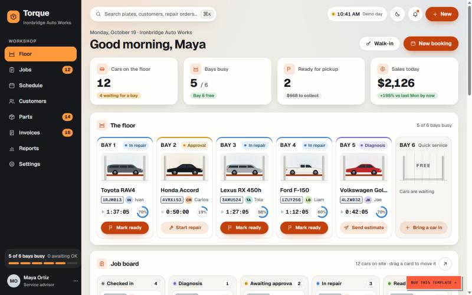

# S-001 Painel do pátio (Floor)
Features: F-001, F-002, F-003, F-004, F-005, F-006 · URL: `#/floor` · Status: draft

## Purpose
Visão única do dia da oficina para o consultor técnico: o que está em cada box, o que espera, o que está pronto para entregar e o que falta comprar. [obs EV-002]

## Entry points
Item "Floor" do menu lateral, logotipo e o resumo de ocupação dos boxes no rodapé do menu. [obs EV-003]

## Anatomy

| # | Region | Contents | Component | Evidence |
|---|---|---|---|---|
| 1 | Cabeçalho | Data, nome da oficina, saudação ao usuário, ações "entrada sem agendamento" e "novo agendamento" | page header | [obs EV-001] |
| 2 | KPIs | 4 cartões: carros no pátio (e quantos esperam box), boxes ocupados/total (e qual está livre), prontos para retirada (e valor a receber), vendas do dia (e comparação com o mesmo dia da semana anterior) | stat card | [obs EV-001] |
| 3 | Boxes | Um cartão por box: etapa, veículo, placa, técnico, tempo decorrido / tempo vendido, % de progresso e a próxima ação da etapa. Box livre mostra convite para trazer um carro | bay card | [obs EV-001] |
| 4 | Quadro de serviços | Colunas por etapa (entrada, diagnóstico, aguardando aprovação, em reparo, pronto), cartão com placa, veículo, cliente, box, prazo e próxima ação; arrastar move de etapa | kanban | [obs EV-002] |
| 5 | Chegadas do dia | Agendamentos com hora, veículo, placa, cliente, motivo e ação de entrada | list | [obs EV-002] |
| 6 | Vendas | Gráfico de 14 ou 30 dias, total, nº de carros e ticket médio | chart | [obs EV-002] |
| 7 | Técnicos | Por técnico: status (livre ou em qual box), horas vendidas e horas apontadas | list | [obs EV-002] |
| 8 | Estoque baixo | Peças abaixo do mínimo: código, local, saldo/mínimo, pedido em aberto | list | [obs EV-002] |
| 9 | Carga da oficina | % do tempo de box agendado, horas agendadas/capacidade, horas livres, carros agendados | stat | [obs EV-002] |
| 10 | Atividade | Feed dos últimos eventos de OS com autor e tempo relativo | feed | [obs EV-002] |

## Data shown

| Element | Entity.field (erp-oficina) | Evidence |
|---|---|---|
| Box | `WorkshopResource` (tipo BOX) | [obs EV-001] |
| Etapa do carro | `WorkOrder.current_stage` | [obs EV-002] |
| Prazo | `WorkOrder.promised_at` | [obs EV-002] |
| Técnico | `WorkOrder.employee` | [obs EV-002] |
| Tempo na etapa | `WorkOrderStageHistory.started_at` | [inf] Q-001 |
| Chegadas | `Appointment` do dia | [obs EV-002] |
| Valor a receber | `WorkOrder.total_geral` das prontas | [obs EV-002] |

## States

| State | How to reach it | What it shows | Evidence |
|---|---|---|---|
| Typical | Abrir a demo | 5 de 6 boxes ocupados, 12 carros no pátio | [obs EV-001] |
| Box livre | Box 6 | Cartão vazio com convite para trazer um carro | [obs EV-001] |
| Empty | Não testado (demo fixa) | | |

## Interactions

| Trigger | Result | Request | Persistence scope | Evidence |
|---|---|---|---|---|
| Ação do cartão do box | Avança a etapa (ex.: em reparo → pronto) | Não testado | | |
| Arrastar cartão no quadro | Move de etapa | Não testado | | |

## Rules

- R-001 a R-004 em `rules/patio.md`.

## Not tested

- Escritas (arrastar, avançar etapa, check-in): ambiente L4, observação apenas.
- Teclado, acessibilidade, responsivo e tempo real: fora do escopo desta sessão.
